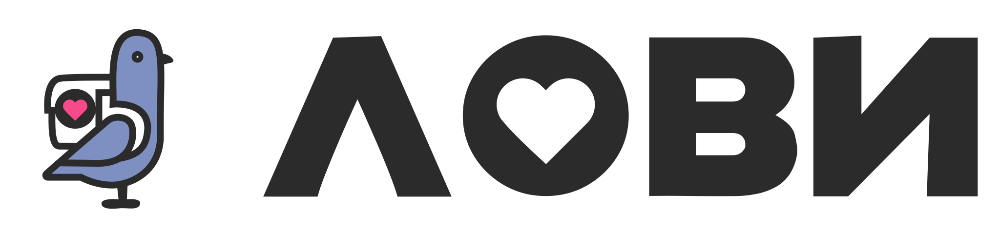

  

  
<a href="https://lovii.ru" target="_blank">
  <picture>
    <source media="(prefers-color-scheme: dark)" srcset="img/lovii-logo-dark.svg">
    <source media="(prefers-color-scheme: light)" srcset="img/lovii-logo.svg">
    
  </picture>
</a>

---

[**English**](README.md) · [**Русский**](README.ru.md)

**Founder / CDTO / IT-Director / CTO / CPO** · 20+ years in IT · St. Petersburg, Russia
  
> *"Great products need great teams. I build the teams."*

---

## Positioning

I run digital transformation end-to-end — from business goal to working platform. What sets me apart from a classic IT director: I work both sides — I design the architecture *and* carry the project through regulation (BPA, 161/115/54/152-ФЗ; SBP / KKT / OFD / FNS). That combination is the usual bottleneck in finance-sensitive industries, and I close it myself.

Led teams of up to 80 people; built engineering and product processes from scratch.

---

## Track record

| Achievement |
|:---|
| Scaled an IT company **5 → 45 engineers**, grew **8** team leads — IT-Park / Digital Lab (2018–2024) |
| Raised project financing from **Sberbank three times (2023–2025) — ₽2.8B to ₽4.1B** for banking and development projects; owned the full path from first call to the bank's commercial offer |
| Built a **fintech loyalty operator + B2B marketplace from zero** (AXIIOM) with full CB RF compliance |
| Founded **MOBIADS** — first dynamic modular mobile ad network in Russia; Runet Prize 2011 nominee; business acquired |
| Led carrier subscription products — **150k+ subscribers**, team 60+ (ZED / Beeline.Kiosk) |

---

## What I do

| Area | Stack |
|:---|:---|
| **Product** | CPO, P&L, Unit Economics, Product Discovery, Roadmap, MVP, RICE/ICE |
| **Management** | Teams up to 80, Agile/Scrum, Hiring, Career Tracks, Motivation |
| **Domain** | Fintech, BPA, 161/115/54/152-ФЗ, SBP, KKT, OFD, FNS |
| **Architecture** | Microservices, Event-driven, HighLoad, API Gateway, REST |
| **Infrastructure** | Kubernetes, Docker, Apache Kafka, PostgreSQL, Linux KVM, CI/CD |
| **Stack** | PHP, Node.js, TypeScript, Python, Swift |

---

## Currently

**CEO & CPO @ [AXIIOM](https://github.com/axiiom-ru)** — building fintech platforms, loyalty ecosystems, and highload IT solutions from the ground up.

- Launched 2 platforms from zero: fintech loyalty operator + B2B marketplace
- Designed microservice event-driven architecture (Kafka, K8s, PostgreSQL)
- Full fintech compliance (BPA, 161/115/54/152-ФЗ; SBP / KKT / OFD / FNS)
- Integrations with banks, telecom, retail, logistics

Also building **LOVII** — white-label SaaS for local marketplaces (micro & small business). *Status: pre-release — release and security in progress, then payments/receipts, payouts and partner onboarding; no transactions yet.*

---

## Case studies

**Scaled an IT function 5 → 45 engineers** — IT-Park / Digital Lab (2018–2024)
Built the holding's IT from zero: dev/test/release processes, Agile/Scrum, RBAC/LDAP/Harbor, CI/CD. Grew 8 team leads from within; cut ops costs 20%.

**₽2.8B–₽4.1B project financing from Sberbank (three times, 2023–2025)** — owned the full path from first call to the bank's commercial offer for banking and development projects; led the technical and compliance work that made the deals viable.

**Fintech from zero, fully compliant** — AXIIOM (2024→)
Launched a loyalty-points operator + B2B marketplace on event-driven microservices; BPA model, 161/115/54/152-ФЗ, SBP / KKT / OFD / FNS; integrations with banks, telecom, retail, logistics.

**First in Russia, then exit** — MOBIADS (2008–2012)
Built the country's first dynamic modular mobile ad network (REST API, SDK); mobtop.ru — Runet Prize 2011 nominee; business acquired.

---

## Projects

58 public repositories with source and 17 private ones shown by name. 🔒 marks repositories whose source stays closed: the name and what it does, no link.

### 🏢 Organisations

Two organisation accounts hold the product and client work that this profile points to:

| Organisation | What it holds | Repos | Public |
|:--|:--|--:|--:|
| [**rucorp**](https://github.com/rucorp) | RuCorp — digital infrastructure for micro and small business: AXIIOM and ATMOSFERA sites, payment tooling, BRIIX. | 19 | 12 |
| [**lovii-tech**](https://github.com/lovii-tech) | LOVII TECH — product organisation of the platform: commerce core, partner cabinet, admin panel, customer app, security and infrastructure. | 11 | 1 |

### 🛍 LOVII — platform for neighbourhood marketplaces

White-label SaaS for launching local marketplaces: a district, a food court, a shopping mall or a city area gets its own audience, catalog and courier network — all running on one shared core. Merchants list goods and services, customers see **what is actually in stock nearby and how many minutes it is on foot**, delivery lands in 15–30 minutes. Status: MVP, mini-pilot completed in Saint Petersburg.

Eleven repositories cover the product end to end: the public white paper and a working storefront demo, the investor site, the commerce core, partner cabinet, admin panel, customer app, design system, documentation corpus, restaurant CRM/ERP and the operating company's site.

<b>11 repositories — 3 public, 8 internal</b>

 

**Public face**

| Repository | What it is | Stack |
|:--|:--|:--|
| [**lovii**](https://github.com/bestdeejay-design/lovii) · [live](https://lovii.ru/) | White paper and the public face of the platform: how a district marketplace works, why the economy is isolated per district, merchant onboarding, MVP status. | HTML · GitHub Pages |
| [**lovii-demo**](https://github.com/bestdeejay-design/lovii-demo) · [live](https://lovii.mobiap.com/) | Working storefront demo on static hosting: 14 shops and 39 products, stock availability, walking distance in minutes, roles of shop, ambassador and investor, light and dark themes. | JavaScript · GitHub Pages |
| [**lovii-invest**](https://github.com/bestdeejay-design/lovii-invest) | Investor site: loyalty programme, payments, marketplace of local offers, unit economics; funding model — equity, not digital assets. | HTML · CSS |

**Internal projects**

| Repository | What it is | Stack |
|:--|:--|:--|
| 🔒 **lovii-core** | Commerce core and the single source of truth across the monorepo: multi-merchant catalog, cart and checkout, orders, loyalty. The only service allowed to write into commerce tables — partner and admin panels go through whitelisted actions. | PHP 8.5 · Laravel 13 · PostgreSQL · Redis · Meilisearch |
| 🔒 **lovii-b2b** | Partner cabinet: merchants, branches, catalog and orders in one panel. Phone + OTP authentication against the core API, multi-tenant, no login/password path at all. | PHP · Filament v5 · PostGIS |
| 🔒 **lovii-admin** | Super-admin panel: roles for support, operations and moderation, plus a full audit trail. Reads core tables read-only and writes only through whitelisted actions. | PHP · Filament v5 · RBAC |
| 🔒 **lovii-app** | Customer mobile web app: shop pages, catalog, cart, checkout and order tracking. | Vue 3 · TypeScript · Vite |
| [**lovii-design**](https://github.com/bestdeejay-design/lovii-design) | Design system «Лови»: tokens, components, theming, Do/Don't rules and acceptance checklists — written for people and AI agents alike, shipped as one CSS file. | HTML · CSS · Design tokens |
| 🔒 **lovii_docs** | Documentation corpus of the platform: 14 modules described as-is against the code, the canon (BRD, PRD, architecture, data model, API spec), analysis of the 85-table database and a gallery of all 60 app screens. | Markdown · HTML |
| [**lovii-crm**](https://github.com/lovii-tech/lovii-crm) · [live](https://lovii-tech.github.io/lovii-crm/) | Restaurant CRM/ERP: from order and receipt to kitchen, product write-offs and couriers. Market research, specifications for 11 domains, franchise book and the legal minimum for launch. | MkDocs Material · GitHub Pages |
| [**platforma**](https://github.com/rucorp/platforma) · [live](https://aoplatforma.ru/) | Corporate site of the operating company behind the local-economy infrastructure: products, solutions, contacts. | HTML · CSS · JS |

---

### 🎧 Fonotext — speech analytics for phone calls

Turns call recordings into structured data: 100% coverage instead of the usual 3% QC sample, transcripts with speakers and timecodes, per-call classification, script compliance with evidence, dashboards.

| Repository | What it is | Stack |
|:--|:--|:--|
| [**fonotext**](https://github.com/bestdeejay-design/fonotext) · [live](https://fonotext.ru/) | Product repository: architecture, ASR/LLM model selection, capacity planning, API spec, POC stand. | Python |
| 🔒 **fonotext-server** | Deployment contour of the stand: server layout, hardware rules, release boundaries between public and private docs. | Python · Markdown |

---

### 💳 Fintech & payment integrations

| Repository | What it is | Stack |
|:--|:--|:--|
| [**mock-services**](https://github.com/rucorp/mock-services) | Mock bank acquiring and fiscal (OFD) services to test payment integrations against official provider protocols — no live terminal needed. | JavaScript · Node.js |

---

### 🖥 macOS apps — the Dajet family

Native Swift apps built around one idea: software that stays quiet. Five repositories: a music player, a browser, a text editor, the shared UI kit that keeps them looking like one family, and a menu-bar pet that keeps the Mac awake. Three are public with source, two stay closed.

<b>5 repositories — 3 public, 2 internal</b>

 

| Repository | What it is | Stack |
|:--|:--|:--|
| [**dajet-player**](https://github.com/bestdeejay-design/dajet-player) | Quiet native music player: SwiftUI + AVFoundation, local library, no cloud, MIT. | Swift · SwiftUI |
| [**dajet-browser**](https://github.com/bestdeejay-design/dajet-browser) | Minimal macOS browser — search fork, MIT; chrome reduced to what you actually use. | Swift · AppKit |
| 🔒 **dajet-editor** | Native text editor for Apple Silicon: Swift 6, AppKit, TextKit 2. | Swift · AppKit |
| 🔒 **dajet-ui** | Shared native UI kit for the whole app family: one visual language, system materials. | Swift · SwiftUI |
| [**sweet-no-sleep**](https://github.com/bestdeejay-design/sweet-no-sleep) | Menu-bar desktop pet Kiwi that keeps your Mac awake — 6★. | Swift · AppKit |

---

### 🎮 Games, music & interactive

Things built for the joy of it, and a reminder that a browser needs no build step to run a game. Eight projects: two real-time strategies on pure Canvas, a collection of mini-games, an interactive philosophical saga in two books, two music galleries, an internet radio with adaptive visuals and a glossy magazine generator.

<b>8 repositories</b>

 

| Repository | What it is | Stack |
|:--|:--|:--|
| [**alien-cosmic**](https://github.com/bestdeejay-design/alien-cosmic) · [live](https://bestdeejay-design.github.io/alien-cosmic/) | Real-time strategy in the browser: 15-mission campaign, 3 factions, base building, fog of war, AI opponent. Pure JavaScript, no build step, no dependencies — 6★. | JavaScript · Canvas |
| [**terran-rts**](https://github.com/bestdeejay-design/terran-rts) | StarCraft-style RTS for GitHub Pages: Canvas rendering and Web Audio, zero dependencies. | JavaScript · Canvas |
| [**minigames**](https://github.com/bestdeejay-design/minigames) | Collection of small browser games — one file each, playable immediately. | JavaScript |
| [**shimmer**](https://github.com/bestdeejay-design/shimmer) · [live](https://bestdeejay-design.github.io/shimmer/) | Shimmer — a philosophical sci-fi saga about consciousness and cycles of time. Two books, read online — 6★. | JavaScript · HTML |
| [**dajet**](https://github.com/bestdeejay-design/dajet) | Creative memory gallery: a music gallery for AI-generated tracks with a full listening experience. | JavaScript |
| [**dj1**](https://github.com/bestdeejay-design/dj1) · [live](https://dj1.ru) | DJ1.RU — music player and gallery, AI tracks by Riffusion, vinyl-style interface. | JavaScript |
| [**joer**](https://github.com/bestdeejay-design/joer) · [live](https://joer.ru) | JOER — internet radio with an adaptive visual atmosphere. | JavaScript · CSS |
| [**qbik**](https://github.com/bestdeejay-design/qbik) | Glossy magazine generator: editor, templates, PDF export. | JavaScript |

---

### 🤖 AI & developer tooling

The part of the work that builds the tools I then work with: local models, agents and the hygiene around them. Twelve repositories — a practical AI handbook that gathered 48 stars, a set of 59 skills for coding agents, a documentation timekeeper, a GitHub-based bus for agent tasks, RAG services on local models, browser utilities for images and SVG, and this catalog itself.

<b>12 repositories — 11 public, 1 internal</b>

 

| Repository | What it is | Stack |
|:--|:--|:--|
| [**awesome-ai-handbook**](https://github.com/bestdeejay-design/awesome-ai-handbook) | Practical guide to AI: from running your first local model to building your own agents — 52 files on LLMs, Ollama, RAG, prompt engineering and local tooling. **48★** | HTML · Markdown |
| [**agent-skills**](https://github.com/bestdeejay-design/agent-skills) · [live](https://bestdeejay-design.github.io/agent-skills/) | 59 skills for AI coding agents: frontend perfection (Lighthouse audit), secret scanner, security review, coverage analyzer, API contract testing, SEO toolkit, repo hygiene. **5★** | Python · JSON manifests |
| [**chronos**](https://github.com/bestdeejay-design/chronos) | Documentation timekeeper — 5 AI agents (Chronos, Censor, Dewey, Veles, Canon) that catch duplicates, broken links, orphans and stale pages. Stdlib-only CLI. | Python |
| 🔒 **agent-hub** | GitHub as the single bus for agents: issue = task, comment = report, PR = result, Actions = execution and audit. | Shell · Actions |
| [**aichat**](https://github.com/bestdeejay-design/aichat) | Local multi-provider chat client for AI models — works fully offline in the browser. | JavaScript |
| [**knowledge-base**](https://github.com/bestdeejay-design/knowledge-base) | RAG service for a corporate knowledge base on free-tier and local models, no paid keys. | TypeScript |
| [**voice-assistant**](https://github.com/bestdeejay-design/voice-assistant) | Voice RAG assistant: Whisper for speech, local knowledge base for answers, macOS speech for replies. | TypeScript · Python |
| [**repo-catalog**](https://github.com/bestdeejay-design/repo-catalog) | Catalog of my own repositories and curated external ones, regenerated by script — the map this list was built from. | Python |
| [**imgforge**](https://github.com/bestdeejay-design/imgforge) | Crop and optimise images right in the browser: ratios, exact sizes, quality, target weight. | JavaScript |
| [**raster-to-svg**](https://github.com/bestdeejay-design/raster-to-svg) | PNG → SVG tracer: pure-Python engine plus vtracer, local web UI with magnifier and presets. | Python |
| [**svg-readme-header-footer**](https://github.com/bestdeejay-design/svg-readme-header-footer) | Single-file editor for animated SVG banners for GitHub READMEs, with live preview. | HTML · JavaScript |
| [**resume**](https://github.com/bestdeejay-design/resume) · [live](https://bestdeejay-design.github.io/resume/) | My resume in CTO / CDTO / CPO versions: master file, build rules, published site. | HTML · Python |

---

### 🏗 Websites & client work

Sites that are live in production rather than sitting in a folder: the AXIIOM corporate site, ATMOSFERA agency, three client domains, a designer's portfolio, two SPbGTI projects — the university site and the historical archive, and several landings. Eleven repositories, most of them static HTML with no build step.

<b>11 repositories — 10 public, 1 internal</b>

 

| Repository | What it is | Stack |
|:--|:--|:--|
| [**axiiom**](https://github.com/rucorp/axiiom) · [live](https://axiiom.ru/) | AXIIOM corporate site — web and mobile development, UI/UX, fintech solutions. | HTML |
| [**arental**](https://github.com/rucorp/arental) · [live](http://arental.ru/) | ATMOSFERA — full-cycle digital agency: lead generation, integrations, marketing automation. | HTML |
| [**fermaruna**](https://github.com/bestdeejay-design/fermaruna) · [live](https://fermaruna.ru) | Farm Runskaya — organic farm in the upper Volga: potatoes, vegetables, farm shop. | HTML |
| [**ksu**](https://github.com/bestdeejay-design/ksu) · [live](https://dajet.ru/) | Portfolio of a graphic designer: identity, branding, typography, UI/UX, illustration, packaging. 16 projects, PWA, EN/RU. | HTML · CSS · PWA |
| [**paffo**](https://github.com/rucorp/paffo) · [live](https://paffo.ru/) | Custom coat atelier — Italian wool, cashmere, leather; two fittings, 21-day production. | HTML |
| [**neo-consulting**](https://github.com/bestdeejay-design/neo-consulting) · [live](https://bestdeejay-design.github.io/neo-consulting/) | Accounting outsourcing landing: 16 sections, SEO, Saint Petersburg. | HTML · GitHub Pages |
| [**semyazdrav.ru**](https://github.com/bestdeejay-design/semyazdrav.ru) · [live](https://semyazdrav.ru/) | Plant care landing plus an SEO knowledge base on feeding indoor plants. | HTML |
| [**SS-BMW-site**](https://github.com/bestdeejay-design/SS-BMW-site) | One-page site for a specialised BMW service: gallery, services, lead form. | HTML · CSS · JS |
| [**spbgti**](https://github.com/bestdeejay-design/spbgti) | SPbGTI university site on Eleventy: history, departments, admissions. | HTML · Eleventy |
| 🔒 **archive-spbgti** · [live](https://archive.ti200.ru/) | Historical archive of SPbGTI: Directus CMS plus gallery — archive.ti200.ru. | HTML · Directus |
| [**univerid**](https://github.com/bestdeejay-design/univerid) · [live](https://univerid.ru/) | UniverID — digital ecosystem for universities: gradebook, schedule, dean's office chat. 2★ | HTML |

---

### ⚙️ Infrastructure, security & engineering practice

What holds the products up and what keeps the decisions written down: an Ansible bootstrap for fresh servers, the security contour with its access matrix, a working inbound mail setup on own domains, domain discovery, a 4,240-line SRS for a delivery aggregator and the venue-category dataset behind the catalogs. Six repositories.

<b>6 repositories — 5 internal, 1 public</b>

 

| Repository | What it is | Stack |
|:--|:--|:--|
| 🔒 **infra** | Ansible bootstrap for servers: Ubuntu 24.04, Headscale/Tailscale networking, Loki/Promtail logs, Nginx + PHP-FPM, PostgreSQL, Laravel deploys. | Ansible · Jinja |
| 🔒 **security** | Security contour of the platform: rules, access matrix, audit results — facts about who can reach what, never secrets. | Shell · Markdown |
| 🔒 **mail** | Inbound mail on own domains: provider comparison, working Postfix + postsrsd setup, DNS zones, runbook, external reviews. | Shell · Postfix |
| 🔒 **domains_finder** | Domain Finder v2: automated search and monitoring of short 2–3 character domains, role-split workers, confidence scoring. | PHP · Docker · Supervisor |
| 🔒 **docs** | Software requirements specification for a grocery-delivery aggregator: 4,240+ lines, 2 volumes, 14 business processes, 7 ADRs. | Markdown |
| [**catalog**](https://github.com/bestdeejay-design/catalog) | Venue categories dataset — hierarchy, icons, ordering — plus validation and analysis scripts. | JavaScript · JSON |

---

### 🧪 Prototypes & demos

Interface prototypes built to prove a flow end-to-end before any backend exists: hotel booking, restaurant search, padel courts, a POS terminal, HR motivation, delivery logistics, an eSIM companion, a food-hub investment landing, a training journal and a pizzeria. Eleven static prototypes, each one openable in a browser.

<b>11 repositories</b>

 

| Repository | What it is | Stack |
|:--|:--|:--|
| [**booking**](https://github.com/bestdeejay-design/booking) | Grand Hotel — room booking demo: catalog, online reservation, cart, payment flow. | JavaScript |
| [**foodie**](https://github.com/bestdeejay-design/foodie) | Restaurant search and booking: 12 cuisines, 8 venues with menus, favourites, chat. | JavaScript |
| [**padl**](https://github.com/bestdeejay-design/padl) | PadelPro — padel club management: court booking, clients, schedule, analytics. | JavaScript |
| [**cashier**](https://github.com/bestdeejay-design/cashier) | Mobile cashier — POS terminal and analytics for cafés and restaurants. | JavaScript |
| [**hrmodule**](https://github.com/bestdeejay-design/hrmodule) | HR Motivation — points, levels, badges and leaderboards for corporate motivation. | JavaScript |
| [**logistics**](https://github.com/bestdeejay-design/logistics) | Logistics — picker and courier apps for assembly and delivery. | JavaScript |
| [**mvno**](https://github.com/bestdeejay-design/mvno) | eSIM Travel — MVNO companion for travellers: eSIM, tours, hotels, flights. | JavaScript |
| [**ambar**](https://github.com/bestdeejay-design/ambar) | AMBAR — investment landing for a food hub with kitchens and IT infrastructure. | HTML |
| [**ishotgirls**](https://github.com/bestdeejay-design/ishotgirls) | ISHOT — training journal: streaks, personal records, gear. | HTML |
| [**mobiap**](https://github.com/bestdeejay-design/mobiap) · [live](https://mobiap.com/) | MOBIAP — English-language landing for fintech platforms: loyalty, payments, PCI DSS. | HTML |
| 🔒 **pizzaloviiru** | Pizzeria landing with a JSON-driven menu and image pipeline. | JavaScript |

---

### 📦 More projects

Beyond the main line: BRIIX and its private workspace, two takes on a personal operating system, the working environment for coding agents, and three more sites.

<b>8 repositories</b>

 

| Repository | What it is | Stack |
|:--|:--|:--|
| [**briix**](https://github.com/rucorp/briix) · [live](https://briix.ru/) | BRIIX — AI marketer: reads a company's site, builds a Brand DNA profile, generates a content plan and on-brand posts, publishes on schedule and reports analytics. Public product site with a 20-slide presentation and unit-economics calculator. | HTML · GitHub Pages |
| 🔒 **briix-internal** | Private workspace of BRIIX: canonical business document, full technical specification, financial model, architecture, risks. | Markdown |
| [**personal-os**](https://github.com/bestdeejay-design/personal-os) | Personal operations centre: notes, kanban, calendar, files, profiles, RAG agent — all local. | TypeScript |
| [**pmos**](https://github.com/bestdeejay-design/pmos) | Event-driven microservice monorepo: 16 CRUD services, NATS JetStream, schema-per-service, 5 sagas, strict TypeScript. | TypeScript · NATS · PostgreSQL |
| [**opencode-setup**](https://github.com/bestdeejay-design/opencode-setup) | Working environment for AI coding agents: configs, MCP servers, skills and a maintenance service. | Shell |
| [**aotochka.ru**](https://github.com/rucorp/aotochka.ru) · [live](https://aotochka.ru/) | Corporate site of JSC Tochka. | JavaScript |
| [**autopulse-sto**](https://github.com/bestdeejay-design/autopulse-sto) | Premium full-cycle car service site on Next.js, dark theme. | TypeScript · Next.js |
| [**agents**](https://github.com/bestdeejay-design/agents) | AXIIOM technology group: digital transformation, fintech, payment integrations, cybersecurity. | HTML |

---

## 🛠 Tech Stack

**Languages**

**Backend & data**

**Infrastructure**

---

## GitHub Activity

---

## Open to & Contact

I'm open to **CDTO / IT-Director / CTO / CPO** roles — full-time or project-based. If you're building (or fixing) a fintech or highload platform and need someone who speaks both architecture and regulation, let's talk.

📄 Resume (CTO / CDTO / CPO versions + full master file): [bestdeejay-design/resume](https://github.com/bestdeejay-design/resume) · online: [bestdeejay-design.github.io/resume](https://bestdeejay-design.github.io/resume/)

Relocation: partial (within Russia) · Business trips: yes

[%20928--74--78-D4A574?style=for-the-badge&logo=phone&logoColor=white)](tel:+79119287478)

St. Petersburg, Russia

---

*CEO @ [AXIIOM](https://github.com/axiiom-ru) — Fintech Infrastructure & Custom IT Solutions for Business*

  

